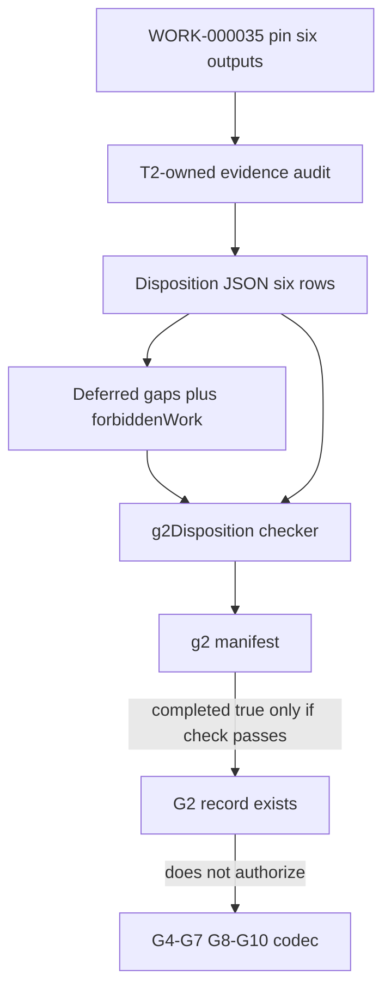
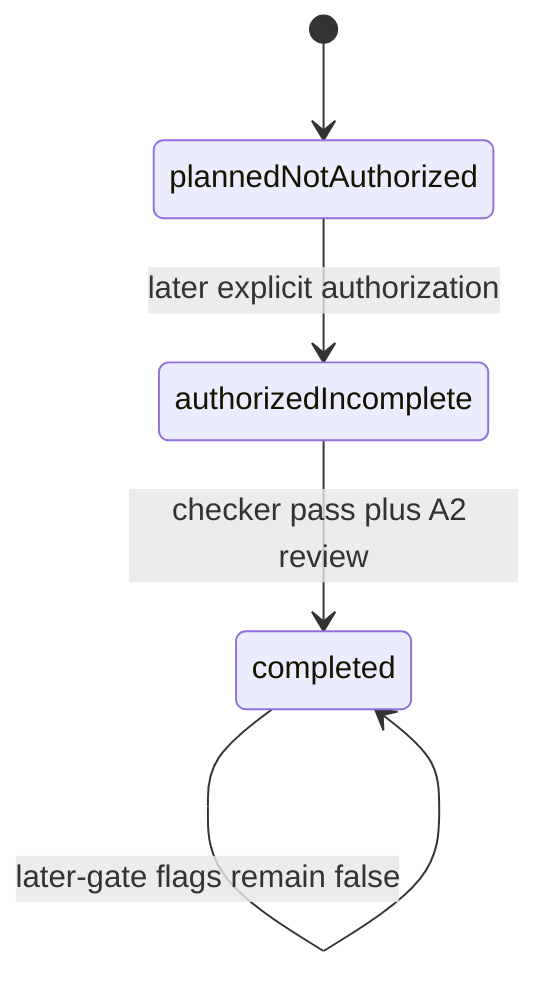

# SCM G2 WORK-000035 pin disposition - Plan

**Product Contract preservation:** extracted from origin G2 (R12, D3/D6, six pin outputs) plus the 2026-08-26 G2 pre-plan pick list. Origin Product Contract IDs are cited, not rewritten.

This plan does not authorize execution. G1 is closed. G2 may be authorized later independently of G3. Completing G2 does not authorize G3, G4–G7, G8–G10, codecs, or live-fabric claims.

---

## Goal Capsule

- **Objective:** Record an explicit T2-owned disposition for every WORK-000035 pin output, with evidence or a stewarded gap, and mechanically forbid codec work while typed equality is unresolved.
- **Product authority:** Origin SCM DoD plan; HHPE WORK-000035 pin (cite, do not copy); T2 ASD-STE100 artifacts as candidate evidence, not automatic proof. Restricted HHPE/Issue 9 text stays outside git.
- **Execution profile:** Test-first checker beside existing SCM G1B checks. JSON disposition plus Markdown rationale. No runtime server bus, codec, or enforcement-expansion program.
- **Stop:** If a unit would ship a codec, nibble alphabet, global dictionary encoding, production encode, English/T3 payload encode, copy restricted pin/Issue 9 prose into git, flip G1B `g3Authorized`, authorize G4–G7, or treat this plan’s existence as authorization to start G2.
- **Tail ownership:** Do not start implementation until an explicit later authorization message says this plan may execute. U1 still creates `docs/scm/g2/manifest.json` with `authorized: false`.

---

## Product Contract

### Summary

G2 is a record-and-guardrail gate. It must make every pin output present, deferred, or not-applicable, and it must enforce the consequence of unresolved gaps. It does not need to close every gap. It must not skip a row. Existing ASD-STE tooling may satisfy some outputs; existence alone does not prove applicability, ownership, completeness, capture-point suitability, or enforcement cutover.

### Problem Frame

G1 closed with `equality_object` unspecified until typed IR exists. Origin R12 forbids a production codec until every applicable pin output exists or is an explicit listed deferral. Without a six-row T2-owned record, later G4–G7 planning cannot tell which work remains forbidden.

### Actors

- A1. **G2 implementer:** Authors disposition artifacts and checker. Not the G2 completion reviewer.
- A2. **G2 completion reviewer (A7 analog):** Independent of A1. Default identity `codex-independent-review`. Not human-operator attestation unless governance later requires it.
- A3. **10,000-foot steward (origin A5):** Sole approver of any `not-applicable` row.
- A4. **Deferred-gap steward:** Named owner of each deferred row’s missing condition. Default `t2-035-disposition-steward` unless a more specific T2-owned path owner is recorded.

### Requirements

**Disposition record**

- R1. Cover exactly these six output IDs, with no duplicates and no extras: `controlled-language-profile`, `owner-attributed-term-dictionary`, `typed-semantic-bindings`, `outward-communication-enforcement`, `controlled-language-equivalence-fixtures`, `explicit-enforcement-cutover`. (origin G2 table)
- R2. Each output has exactly one status: `present`, `deferred`, or `not-applicable`.
- R3. `present` requires evidence pointer, owner/steward, version identity, effective scope, and why it is the applicable T2 profile/dictionary/enforcement/fixture/cutover.
- R4. `deferred` requires `gapId`, steward, missing condition, consequence, non-empty `forbiddenWork`, and `closureEvidence`.
- R5. `not-applicable` requires source-law rationale and A3 approval identity. It is not a substitute for missing evidence.
- R6. No pin output may be omitted or silently skipped. (origin G2)

**Capture point and codec**

- R7. Record capture point as after T2 governed translation and before CAN encode. Status is `open` until a typed IR exists. (origin G2)
- R8. If typed IR is absent, the row must be `deferred`. Missing IR without explicit deferral fails the checker.
- R9. While typed equality is unresolved, forbidden work includes at least: SCM/CAN codec, nibble alphabet, global dictionary encoding, production encode, encoding English, encoding T3 payload, claiming semantic parity at G9. (origin R12, G2 still-forbidden list)
- R10. G3 topology mapping is not forbidden by IR deferral. Non-codec G4–G7 prototype work remains blocked by _this_ plan’s non-authorization of later gates, not by G2 IR deferral itself. (origin G2 T2 delta)

**Evidence and restricted sources**

- R11. Evidence pointers are T2-owned repo paths or approved external references (`T2-SQUARED-References/` document/section/ID/version/hash). Do not copy restricted HHPE pack or Issue 9 prose into git. (origin R15)
- R12. Keep lexicon token `canBus` and SCM campaign vocabulary distinct. G2 must not silently normalize them. (origin R16)

**Enforcement scope of this gate**

- R13. G2 records current outward-enforcement fact. It does not expand enforcement coverage. Missing enforcement becomes a named deferred gap, not a remediation program inside G2.
- R14. A scanner, advisory report, CI check, admission gate, runtime boundary, human review, and enforcement cutover are distinct. A scanner existing does not prove outward enforcement.

**Authorization**

- R15. G2 lives in `docs/scm/g2/manifest.json`. Initial state is `planned-not-authorized` / `authorized: false` / `completed: false` / `doesNotAuthorizeLaterGates: true`.
- R16. Do not reuse G1B `g3Authorized` as an implementation switch. G1B remains historical evidence that G1 closure authorized nothing downstream.
- R17. Manifest must not claim G2 complete unless the disposition checker passes.
- R18. G2 completion does not authorize G3, G4–G7, G8–G10, codecs, clocks, cutover, or live-fabric claims.
- R19. Independent review of G2 completion uses identity `codex-independent-review`. Human A7 remains a separate obligation if governance requires it.

### Key Flows

- F1. Audit T2-owned ASD-STE artifacts against each pin output. Record present or deferred. Do not upgrade to present on existence alone.
- F2. Materialize six disposition rows plus capture-point record. Derive the union forbidden-work policy from unresolved codec-relevant gaps.
- F3. Checker rejects illegal IDs, missing gap fields, omitted rows, and any state that would permit a codec while typed equality is unresolved.
- F4. Completion review may approve G2 only when the checker passes and later-gate flags remain false.

### Acceptance Examples

- AE1. Covers R1, R2. Given a disposition file, when an output ID is missing or a seventh ID is added, then the checker fails with a set-equality code.
- AE2. Covers R8, R9. Given typed IR deferred and no codec files, then the checker passes. Given typed IR absent without deferral, then the checker fails.
- AE3. Covers R9. Given IR deferred and a row whose `forbiddenWork` omits codec or nibble alphabet, then the checker fails.
- AE4. Covers R5. Given `not-applicable` without A3 steward, then the checker fails.
- AE5. Covers R17, R18. Given checker green and `completed: true` with `g4toG7Authorized: true` (or any later-gate flag), then the checker fails.
- AE6. Covers R11. Given an evidence pointer that inlines restricted Issue 9 body text, then the checker fails.

### Scope Boundaries

**In scope:** six-row disposition, rationale, manifest, loader/checker, mutation tests, forbidden-work policy derived from gaps.

**Deferred for later:** closing deferred gaps; expanding Forgejo/admission coverage; choosing the first typed IR (origin OQ2); naming-gate SCM vs `canBus`; G4 W1 types.

**Outside this product's identity:** production codec; nibble alphabet; global dictionary; encoding English or T3 payload; copying Issue 9/HHPE pack into git; G3 topology (sibling plan); live-fabric claims.

### Sources

- Origin: `docs/plans/2026-08-23-002-feat-scm-dod-gates-plan.md` G2 section.
- Candidate T2 evidence (audit, do not treat as proof): `t2.asd-ste100.json`, `t2.asd-ste100.rules.json`, `t2.asd-ste100.terms.json`, `t2.asd-ste100.ownership.json`, `t2.asd-ste100.reviewers.json`, `t2.asd-ste100.anchor.json`, `T2_Squared-Work-Registry/asd-ste100-compliance/`, `scripts/asd-ste100/`, `docs/internals/asd-ste100-enforcement.md`, `docs/internals/asd-ste100-remediation-w1.md`, `docs/operations/asd-ste100-forgejo.md`, prior ASD-STE plans under `docs/plans/`.
- Restricted pin source: cite `T2-SQUARED-References/` (CAN packs / `work-000035-pin.md`) by ID/hash only.
- Sibling plan (not a dependency): `docs/plans/2026-08-26-002-feat-scm-g3-node-bus-map-plan.md`.
- Checker pattern: `apps/server/src/scm/g1bInventory.ts` and `apps/server/src/scm/g1bCompleteness.test.ts`.

---

## Planning Contract

### Key Technical Decisions

- KTD1. **Two independent plans.** G2 consumes WORK-000035 evidence. G3 consumes G1 inventory. This file is G2 only.
- KTD2. **Per-gate manifest.** Authorization lives in `docs/scm/g2/manifest.json`, not in G1B and not only in the origin requirements artifact.
- KTD3. **Pointers and dispositions only.** Git stores T2-owned records. Restricted bundle stays external.
- KTD4. **JSON disposition plus Markdown rationale.** Loader/checker in `apps/server/src/scm/` mirrors G1B. No runtime server feature.
- KTD5. **G2 is disposition, not remediation.** Incomplete enforcement or fixtures become deferred gaps.
- KTD6. **Starting posture unless audit proves present.** Profile, dictionary, and outward enforcement start as deferred with candidate evidence listed. Typed IR, equivalence fixtures, and pin-complete cutover start as deferred. Codec remains forbidden. G3 is unaffected.
- KTD7. **Why not present for the mechanical subset.** `t2.asd-ste100.json` is a versioned mechanical rule-subset (`claim`: ASD-STE100 mechanical rule-subset result). `docs/internals/asd-ste100-enforcement.md` states it is not a language-authority certificate. Forgejo admission plus `npm run ci:asd-ste100` is evidence toward enforcement, not proof that every applicable outward boundary is mandatory. `t2.asd-ste100.anchor.json` `protectionActivation: active` is mechanical-subset admission cutover, not WORK-000035 pin-complete cutover.
- KTD8. **IR deferral steward.** A4 default `t2-035-disposition-steward`. Closure evidence must name a concrete typed T2 semantic object at the capture point. Origin OQ2 (which IR first) stays open and does not block G2 completion via deferral.
- KTD9. **`canBus` stays a product token.** Dictionary audit must not treat SCM campaign terms as aliases of `canBus`.
- KTD10. **Completion review.** Codex identity `codex-independent-review`. Human attestation remains separate if required.

### High-Level Technical Design





Capture point (directional, not a type implementation):

```text
T2 governed translation
        ↓
typed semantic object / equality oracle   ← missing; row deferred
        ↓
future CAN/SCM encoding                   ← forbidden while unresolved
```

### Assumptions

- G1 remains closed and is not reopened by G2.
- No typed IR currently exists at the required capture point (`docs/scm/g1b/inventory.json` `equalityNote` still points at missing IR).
- Lexicon interpret/normalize tests and scanner-accepts-phrase tests are not semantic-equivalence fixtures.
- Heuristic ASD-STE findings that do not fail the suite are not outward enforcement.
- Sibling G3 plan may execute in parallel after its own authorization.

### Sequencing

U1 schema and failing checker tests → U2 six-row disposition and rationale (audit may keep deferred) → U3 checker green against the record → U4 forbidden-work and mutation tests → U5 manifest/README completion state with later gates false.

---

## Output Structure

```text
docs/scm/g2/
  README.md
  manifest.json
  work-000035-disposition.json
  rationale.md
apps/server/src/scm/
  g2Disposition.ts
  g2Disposition.test.ts
```

---

## Implementation Units

### U1. Closed disposition schema and failing checks

- **Goal:** Freeze output IDs, status vocabulary, and checker failure codes before any row is treated as complete.
- **Requirements:** R1, R2, R15, R16
- **Dependencies:** none
- **Files:** `docs/scm/g2/manifest.json`, `docs/scm/g2/work-000035-disposition.json` (skeleton), `apps/server/src/scm/g2Disposition.ts`, `apps/server/src/scm/g2Disposition.test.ts`
- **Approach:** Mirror G1B load/check split. Manifest starts `status: planned-not-authorized`, `authorized: false`, `completed: false`, `doesNotAuthorizeLaterGates: true`. Skeleton lists the six IDs with illegal or empty statuses so tests fail until U2/U3.
- **Execution note:** Write failing tests for exact six-ID set, closed status vocabulary, and G1B non-mutation before filling rows.
- **Patterns to follow:** `apps/server/src/scm/g1bInventory.ts` package loader and `apps/server/src/scm/g1bCompleteness.test.ts`.
- **Test scenarios:**
  - Happy path: loader reads `docs/scm/g2/` from repo root the same way G1B does.
  - Edge: duplicate output ID fails; unknown ID fails; empty status fails.
  - Error: G1B `docs/scm/g1b/manifest.json` `g3Authorized` remains false after G2 files exist.
- **Verification:** New tests fail for the right codes. G1A/G1B tests still pass.

### U2. Evidence audit and six materialized rows

- **Goal:** Audit candidate ASD-STE evidence and write all six dispositions plus capture-point record and rationale.
- **Requirements:** R3–R8, R11–R14
- **Dependencies:** U1
- **Files:** `docs/scm/g2/work-000035-disposition.json`, `docs/scm/g2/rationale.md`
- **Approach:** For each output, list candidate evidence paths and either prove `present` against R3 or record `deferred` against R4. Default per KTD6/KTD7 unless the audit finds a concrete typed IR or pin-complete cutover. Record `pin`, `sourceVersion` as a T2-owned hash or `T2-SQUARED-References/` pointer, and capture point `status: open`. Include `canBus` as a dictionary product token that is not SCM. Restricted sources appear as ID/hash pointers only.
- **Execution note:** Do not copy Issue 9 or pin prose. Summaries must be T2-owned.
- **Patterns to follow:** G1B coverage quotes that match frozen G1A text without expanding restricted sources.
- **Test scenarios:**
  - Happy path: all six IDs present in JSON; each deferred row has gap fields; rationale has one section per output.
  - Edge: profile/dictionary/enforcement rows cite T2-owned paths that exist on disk.
  - Error: a `present` row with empty evidence array fails later in U3; U2 must not ship that shape.
- **Verification:** Disposition JSON parses. Every cited T2 path exists. No restricted verbatim body in git.

### U3. Disposition checker

- **Goal:** Mechanically enforce R1–R9, R11, R17.
- **Requirements:** R1–R9, R11, R17
- **Dependencies:** U2
- **Files:** `apps/server/src/scm/g2Disposition.ts`, `apps/server/src/scm/g2Disposition.test.ts`
- **Approach:** Check set equality of output IDs; per-status required fields; capture-point openness when IR is deferred; evidence pointers are non-empty strings that are repo-relative or `T2-SQUARED-References/` prefixes, not inline restricted bodies; typed IR absent without deferral fails; typed IR deferred plus codec-absent passes.
- **Execution note:** Implement new checker behavior test-first.
- **Patterns to follow:** G1B `closure-tuple` and coverage-id-set failures.
- **Test scenarios:**
  - Happy path: Covers AE2. Current deferred-IR record passes.
  - Error: Covers AE1. Omit `typed-semantic-bindings` → fail.
  - Error: IR row status `present` without version identity → fail.
  - Error: Covers AE4. `not-applicable` without A3 steward → fail.
  - Error: Covers AE6. Evidence value contains a multi-paragraph Issue 9 excerpt marker/body → fail.
- **Verification:** Checker reports `ok: true` on the U2 record and `ok: false` on each mutation above.

### U4. Forbidden-work policy and codec-permit mutations

- **Goal:** Derive union forbidden work from unresolved codec-relevant gaps and fail any record that would permit a codec.
- **Requirements:** R9, R10
- **Dependencies:** U3
- **Files:** `apps/server/src/scm/g2Disposition.ts`, `apps/server/src/scm/g2Disposition.test.ts`, `docs/scm/g2/work-000035-disposition.json`
- **Approach:** Union `forbiddenWork` across deferred/NA codec-relevant rows. Require the R9 minimum set whenever IR is not `present`. Completing G2 with those bans does not by itself authorize G4–G7.
- **Test scenarios:**
  - Happy path: derived policy includes codec, nibble alphabet, global dictionary, production encode, English encode, T3 payload encode, G9 semantic-parity claim.
  - Error: Covers AE3. Remove `codec` from IR gap `forbiddenWork` → fail.
  - Edge: G3 overlay files may exist or not; G2 checker does not require them and does not forbid them.
- **Verification:** Mutations fail. Policy is readable from checker output or a derived field on the disposition record.

### U5. README, review state, and later-gate non-authorization

- **Goal:** Document G2 as a record that can later be marked complete without authorizing downstream gates.
- **Requirements:** R15–R19
- **Dependencies:** U4
- **Files:** `docs/scm/g2/README.md`, `docs/scm/g2/manifest.json`, `apps/server/src/scm/g2Disposition.test.ts`
- **Approach:** README states G2 is disposition only, lists remaining gaps, states codec forbidden, states G3 unaffected, states Codex review is not human attestation. Manifest may move to `completed: true` only after checker pass and A2 review; this unit leaves `authorized` and `completed` false unless a later authorization/review message says otherwise. Checker rejects `completed: true` when checker would otherwise fail, and rejects any later-gate authorization flag.
- **Test scenarios:**
  - Happy path: README names all six outputs and the R9 ban list.
  - Error: Covers AE5. `completed: true` plus a later-gate flag → fail.
  - Edge: G1B manifest `g3Authorized` still false.
- **Verification:** G2 tests pass. G1A/G1B tests pass. `git diff --check` passes. G1B historical flags unchanged.

---

## Verification Contract

| Gate                   | Command / outcome                                                             | Applies              |
| ---------------------- | ----------------------------------------------------------------------------- | -------------------- |
| G2 checker tests       | From `apps/server`, `vp test run src/scm/g2Disposition.test.ts`               | U1–U5                |
| G1 non-regression      | `vp test run src/scm/g1aCompleteness.test.ts src/scm/g1bCompleteness.test.ts` | after U1 and U5      |
| Whitespace             | `git diff --check`                                                            | before claiming done |
| Restricted-source scan | Grep G2 artifacts for Issue 9 body / HHPE pack prose                          | U2, U5               |
| Authoritative CI       | Local `vp test run` / repo `scripts/ci` only. Not GitHub Actions              | all                  |

Do not run unrelated production-machine lanes (reboot, soak, E5, full release suite) to close G2.

---

## Definition of Done

**Global**

- Six pin outputs are dispositioned. No silent skips.
- Checker passes on the recorded package and fails the required mutations.
- Codec-relevant unresolved gaps forbid the R9 set.
- Manifest does not authorize G3 or G4–G7.
- G1B remains unchanged historical evidence.
- No restricted pin/Issue 9 prose in git.
- Abandoned-attempt code is absent from the diff.

**Per unit:** U1 failing schema tests exist; U2 six rows and rationale exist; U3 checker green on the record; U4 forbidden-work mutations fail as specified; U5 README and later-gate tests exist.

---

## Risks & Dependencies

- **False `present`.** Mitigate with KTD7 and R3. Existence of `t2.asd-ste100.json` is not a language-authority certificate.
- **Collapsed gaps.** IR missing must not absorb the fixtures row. Fixtures get their own deferred gap.
- **Enforcement creep.** R13 forbids turning G2 into an admission-coverage program.
- **Authorization drift.** Plan existence is not `authorized: true`.
- **Dependency:** G1 closed. Independent of G3. Restricted pin files must remain readable as pointers, not imported text.

---

## Open Questions

- OQ-G2-1. **Deferred.** Origin OQ2: which typed IR is first (orchestration command vs admission vs git execute). G2 completes by deferring IR.
- OQ-G2-2. **Deferred.** Whether governance requires human approval of G2 completion in addition to Codex identity. Same split as G1.
- OQ-G2-3. **Deferred.** Whether a later audit upgrades profile, dictionary, or mechanical-subset enforcement from `deferred` to `present` without expanding G2 into remediation.

No launch-blocking open questions remain for this disposition gate.
