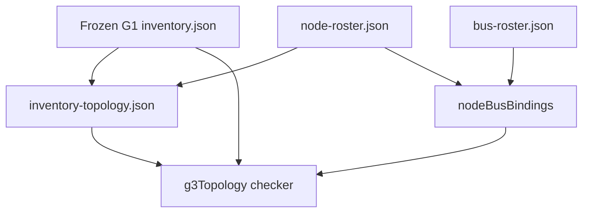
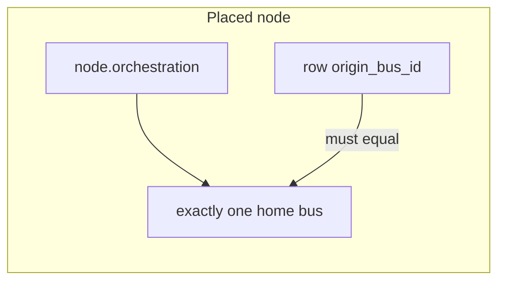

# SCM G3 node and bus map - Plan

**Product Contract preservation:** extracted from origin G3 (R8, R10, D9 roster) plus the 2026-08-26 G3 pre-plan pick list. Origin Product Contract IDs are cited, not rewritten.

This plan does not authorize execution. G1 is closed. G3 may be authorized later independently of G2. Completing G3 does not authorize G4–G7, W1, codecs, clocks, or live-fabric claims. G1 inventory files remain frozen inputs.

---

## Goal Capsule

- **Objective:** Map every frozen G1 `comm_id` onto a T2-owned node/bus overlay: one home bus per placed node, stewarded unknowns, reserved 404 with halt `no`, and no runtime SCM fabric.
- **Product authority:** Origin SCM DoD plan G3; frozen G1B inventory `docs/scm/g1b/inventory.json`. Restricted HHPE pack stays outside git.
- **Execution profile:** Data-oriented overlay plus a small checker beside G1B. No runtime bus, W1 type, codec, or process-global “the bus.”
- **Stop:** If a unit would mutate G1 artifacts, bind halt to a concrete initiator `yes`, declare manifold a runtime node, ship W1/codec/nibble/clock parameters, flip G1B `g3Authorized`, or treat this plan’s existence as authorization to start G3.
- **Tail ownership:** Do not start implementation until an explicit later authorization message says this plan may execute. U1 still creates `docs/scm/g3/manifest.json` with `authorized: false`.

---

## Product Contract

### Summary

G3 consumes completed G1 inventory and produces a T2-owned topology overlay keyed by immutable `comm_id`. A node is a CAN-facing component identity, not a process, catalog boundary, or inventory row. Buses are provisional domain buses. Completing G3 is prototype topology, not live fabric law.

### Problem Frame

Origin OQ4 waited on G1. G1 is closed with 73 D15C rows whose `home_or_authority` is still unknown. Without an overlay, G4 cannot attach origin `bus_id` to a node home, and D9 roster semantics (including 404 cannot halt) have no T2-owned place to live. Mutating G1 `inventory.json` would rewrite closed historical evidence.

### Actors

- A1. **G3 implementer:** Authors overlay, rosters, and checker. Not the completion reviewer.
- A2. **G3 completion reviewer:** Independent of A1. Default identity `codex-independent-review`. Not human-operator attestation unless governance later requires it.
- A3. **Provisional ID steward:** Owns `node.*` / `bus.*` names. Default `t2-server-host`. Rename is not a topology change.
- A4. **Placement-gap steward:** Owns each `unplaced` or `unknown` field.

### Requirements

**Overlay and G1 freeze**

- R1. Every G1 `comm_id` appears exactly once in `docs/scm/g3/inventory-topology.json`. Unexpected IDs fail. (origin G3 DoD)
- R2. G1 files under `docs/scm/g1a/` and `docs/scm/g1b/inventory.json` remain byte-stable inputs. Topology is an overlay, not a G1 field edit.
- R3. Empty strings are forbidden. Omitted G1 rows are forbidden.

**Nodes and grouping**

- R4. Rows share a node only when they represent the same CAN-facing component identity and compatible home placement. Sharing `apps/server` is not enough.
- R5. Each mapping names a known roster node or `unplaced`. `unplaced` requires `gapId`, steward, reason, and `resolutionEvidence`.
- R6. External vendor/services are endpoints on mappings, not T2 nodes. Short-lived utility commands are endpoints of the owning parent node. Long-lived behavior-bearing provider/runtime subprocesses are child nodes.

**Buses and relationships**

- R7. Bus identity is separate from node-to-bus relationship. Allowed relationships: `home`, `authority`, `linked`, `permissioned-child`, `unknown`. (origin R8)
- R8. Every placed node has exactly one home bus. No node has two homes. (origin R8)
- R9. Every bus has a steward. `permanent: true` requires explicit permanence approval; default is `permanent: false`.
- R10. For every row mapped to a placed node, `origin_bus_id` equals that node’s home bus. No W1 word type is introduced. (origin G3 test)

**Authority**

- R11. Each node has a baseline authority. Each mapped row keeps its G1 `authority_class`. Conflicting combinations that would change node class without a recorded exception fail review.
- R12. Observer nodes remain observer even when they transport information about A2 activity. `human` is an actor classification on the editor-launch row, not a bus class.

**Unknown vs unplaced**

- R13. `unplaced` means CAN-facing component identity is not yet determined. `unknown` means the field exists but the value is not determined. `unknown` relationship or bus class requires steward and resolution condition. A placed node must not have `home_bus_id: null`.

**Halt and 404**

- R14. Roster field `halt_initiator` is `yes` | `no` | `open`. No node may be `yes`. Observer nodes and reserved 404 are `no`. Other candidates stay `open`. (origin R10)
- R15. Reserved non-live identity `node.observer.404` exists with `halt_initiator: no`, `live_g1_comm_ids: []`, and `placementStatus: reserved`. Do not fabricate a G1 communication row. (origin D9/D10; G1 found no live 404 path)

**Naming and non-claims**

- R16. `node.*` and `bus.*` are provisional campaign identifiers. Do not treat `canBus` as a bus ID namespace. (origin R16)
- R17. Manifold is not a runtime-owned node. No process-global object is “the bus.”
- R18. No W1 encoding, codec, numeric bus code, nibble value, or clock parameter appears in G3 artifacts.

**Authorization**

- R19. G3 lives in `docs/scm/g3/manifest.json`. Initial state is `planned-not-authorized` / `authorized: false` / `completed: false` / `doesNotAuthorizeLaterGates: true`.
- R20. Do not reuse G1B `g3Authorized` as an implementation switch.
- R21. G3 completion does not authorize G4–G7. Separate approval is required before G4 planning becomes authorizing work.
- R22. Independent review uses identity `codex-independent-review`. Human approval of topology assignments remains separate if governance requires it.

### Key Flows

- F1. Freeze the G1 `comm_id` set as overlay input.
- F2. Apply the grouping rule to produce node and bus rosters, then map every row.
- F3. Add reserved 404 with halt `no`. Assign halt `no` to observers and `open` to other candidates.
- F4. Checker proves exact coverage, one home per placed node, origin-bus invariant, and halt bans.

### Acceptance Examples

- AE1. Covers R1. Deleting one G1 `comm_id` from the overlay fails completeness.
- AE2. Covers R1. Adding an unknown `comm_id` fails.
- AE3. Covers R8. A second home binding for `node.orchestration` fails.
- AE4. Covers R10. Overlay `origin_bus_id` that differs from the node home fails.
- AE5. Covers R14, R15. `halt_initiator: yes` on any node, or `no` missing on 404/observer, fails.
- AE6. Covers R17. A roster node named as the manifold fails.
- AE7. Covers R2. Checker loads G1 inventory read-only; a test that the overlay does not rewrite G1 files passes.

### Scope Boundaries

**In scope:** node roster, bus roster, inventory overlay, reserved 404, halt roster field, topology checker, mutation tests, G3 manifest/README.

**Deferred for later:** W1 word constructor (G4); concrete halt initiator binding (G7/Increment 4–6); permanence of bus IDs; naming-gate SCM vs `canBus`; DIP mute (G6); clocks (G8).

**Outside this product's identity:** runtime bus implementation; process-global singleton bus; live-fabric claim; G2 pin disposition (sibling plan); mutating closed G1 artifacts.

### Sources

- Origin: `docs/plans/2026-08-23-002-feat-scm-dod-gates-plan.md` G3 section and R8/R10.
- Frozen input: `docs/scm/g1b/inventory.json` (73 rows), `docs/scm/g1b/manifest.json` (G1 closed).
- Sibling plan (not a dependency): `docs/plans/2026-08-26-001-feat-scm-g2-work-000035-disposition-plan.md`.
- Checker pattern: `apps/server/src/scm/g1bInventory.ts`.

---

## Planning Contract

### Key Technical Decisions

- KTD1. **Overlay keyed by immutable G1 `comm_id`.** Do not add topology columns to G1 `inventory.json` or `coverage.json`.
- KTD2. **Component nodes, not one node per row.** 73 row-nodes would be artificial. Catalog-boundary nodes would drop unwrapped MCP. One process-node would collapse topology.
- KTD3. **External systems are endpoints.** Provider runtimes Codex/Claude/Cursor/Grok/OpenCode are child nodes of `node.provider`. Terminal PTY stays an endpoint of `node.terminal` unless a later review proves independent word publication. Git/CLI/cloudflared short-lived commands are endpoints of `node.vcs` / `node.source-control` / `node.network`.
- KTD4. **Provisional domain buses, resolving origin OQ4.** Many home buses may coexist in `apps/server`. Not one server-wide home bus, and not one bus per node. Starting buses: `bus.control`, `bus.rpc`, `bus.provider`, `bus.persistence`, `bus.terminal`, `bus.observer`, `bus.network`, `bus.vcs`.
- KTD5. **Relationship is not bus class.** Store class-like authority on the bus only as a baseline label if needed; store `home` / `authority` / `linked` / `permissioned-child` on `nodeBusBindings`.
- KTD6. **Node baseline plus row-specific authority.** A node may own A1 and A2 rows (`node.rpc` does). `node.lifecycle` may own the `human` editor-launch row without becoming a human node. Observer nodes stay observer. Conflicts fail review rather than silently max-merge into a new class.
- KTD7. **404 is reserved non-live.** G1 discovered no live 404 path. Roster still needs D9/D10 halt `no`.
- KTD8. **Origin-bus invariant without W1.** Overlay carries `origin_bus_id` equal to node home. G4 will later put that value on a word type.
- KTD9. **Process flags map to the configured component**, not to a synthetic flags node.
- KTD10. **T2 observer, T3 observer, analytics, and resource telemetry are separate nodes.** G1 already split desktop input, control, and native monitor.
- KTD11. **G3 completion does not authorize G4.** Sibling G2 is not a prerequisite for G3 execution.

### High-Level Technical Design





Group rule (directional):

```text
same CAN-facing component identity
AND compatible home placement
AND not “same process” alone
→ share node_id
else own node or stewarded unplaced
```

### Assumptions

- G1 row count and IDs remain the closed set in `docs/scm/g1b/inventory.json`.
- Starting roster below is the planned assignment, not a sketch the implementer may replace without a recorded exception.
- `INV-T2-MCP-HTTP` stays its own node because G1 bound it as the negative-control identity.
- `INV-T2-FILE-ATTACHMENTS` is `node.assets`; `INV-T2-FILE-USAGE-CACHE` is `node.usage`; secrets map to `node.auth`.
- Parallel G2 work does not change G3 inputs.

### Sequencing

U1 manifest + G1 freeze check → U2 rosters and bindings → U3 overlay of all 73 rows → U4 404/halt → U5 checker and mutations → U6 README and later-gate non-authorization.

### Starting node and bus assignment

**Domain buses (all `permanent: false`, steward `t2-server-host`):**

| bus_id            | Typical home nodes                                                                       |
| ----------------- | ---------------------------------------------------------------------------------------- |
| `bus.rpc`         | `node.rpc`, `node.mcp`, `node.preview`                                                   |
| `bus.control`     | `node.orchestration`, `node.auth`, `node.lifecycle`, `node.settings`, `node.project`     |
| `bus.provider`    | `node.provider` and provider child nodes                                                 |
| `bus.persistence` | `node.persistence`, `node.projection`, `node.assets`, `node.usage`                       |
| `bus.terminal`    | `node.terminal`                                                                          |
| `bus.observer`    | observer nodes and reserved 404 (404 has null home until placed; reserved stays unhomed) |
| `bus.network`     | `node.network`, `node.relay`                                                             |
| `bus.vcs`         | `node.vcs`, `node.source-control`                                                        |

**Core / other nodes and G1 rows:**

| node_id                   | halt | baseline | G1 `comm_id` set                                                                                                                                                |
| ------------------------- | ---- | -------- | --------------------------------------------------------------------------------------------------------------------------------------------------------------- |
| `node.rpc`                | open | A2       | `INV-T2-RPC-WS`, `INV-T2-HTTP-META`, `INV-T2-HTTP-AUTH`, `INV-T2-HTTP-ORCH`, `INV-T2-HTTP-PR`, `INV-T2-HTTP-CONNECT`, `INV-T2-HTTP-SERVE`, `INV-T2-HTTP-STATIC` |
| `node.mcp`                | open | A1       | `INV-T2-MCP-HTTP`                                                                                                                                               |
| `node.orchestration`      | open | A2       | `INV-T2-ORCH-RPC`, `INV-T2-RPC-STREAM-ORCH`, `INV-T2-ORCH-LIVE`, `INV-T2-ORCH-QUEUE`, `INV-T2-ORCH-EVENTS`                                                      |
| `node.projection`         | open | A2       | `INV-T2-PROJECT-READ`, `INV-T2-PROJECT-QUEUE`, `INV-T2-PROJECT-SQL`                                                                                             |
| `node.provider`           | open | A2       | `INV-T2-PROVIDER-TURN`, `INV-T2-PROVIDER-EVENTS`, `INV-T2-PROVIDER-LIST-EVENTS`, `INV-T2-PROVIDER-PERM`, `INV-T2-FILE-PROVIDER-SESSION`                         |
| `node.provider.codex`     | open | A2       | `INV-T2-PROVIDER-CODEX`, `INV-T2-FLAG-CODEX-LAUNCH`                                                                                                             |
| `node.provider.claude`    | open | A2       | `INV-T2-PROVIDER-CLAUDE`                                                                                                                                        |
| `node.provider.cursor`    | open | A2       | `INV-T2-PROVIDER-CURSOR`                                                                                                                                        |
| `node.provider.grok`      | open | A2       | `INV-T2-PROVIDER-GROK`                                                                                                                                          |
| `node.provider.opencode`  | open | A2       | `INV-T2-PROVIDER-OPENCODE`                                                                                                                                      |
| `node.terminal`           | open | A2       | `INV-T2-RPC-STREAM-TERM`, `INV-T2-TERM`, `INV-T2-FLAG-TERM-ENV`                                                                                                 |
| `node.persistence`        | open | A2       | `INV-T2-SQLITE`, `INV-T2-FILE-RUNTIME-STATE`, `INV-T2-FILE-CHECKPOINTS`                                                                                         |
| `node.settings`           | open | A2       | `INV-T2-FILE-SETTINGS`, `INV-T2-SETTINGS-EVENTS`, `INV-T2-FLAG-SERVER-CONFIG`                                                                                   |
| `node.auth`               | open | A1       | `INV-T2-RPC-STREAM-AUTH`, `INV-T2-FILE-SECRETS`                                                                                                                 |
| `node.assets`             | open | A2       | `INV-T2-FILE-ATTACHMENTS`                                                                                                                                       |
| `node.usage`              | open | A2       | `INV-T2-FILE-USAGE-CACHE`                                                                                                                                       |
| `node.vcs`                | open | A2       | `INV-T2-RPC-STREAM-DISCOVERY`, `INV-T2-VCS-EVENTS`, `INV-T2-FILE-WORKTREES`, `INV-T2-GIT`                                                                       |
| `node.source-control`     | open | A2       | `INV-T2-SC-GITHUB`, `INV-T2-SC-GITLAB`, `INV-T2-SC-ADO`, `INV-T2-SC-BITBUCKET`                                                                                  |
| `node.preview`            | open | A2       | `INV-T2-PREVIEW-AUTO`, `INV-T2-PREVIEW-SCAN`                                                                                                                    |
| `node.project`            | open | A2       | `INV-T2-PROJECT-SETUP`                                                                                                                                          |
| `node.lifecycle`          | open | A2       | `INV-T2-RPC-STREAM-CONFIG`, `INV-T2-LIFECYCLE-EVENTS`, `INV-T2-EDITOR-LAUNCH` (row authority `human`)                                                           |
| `node.relay`              | open | A2       | `INV-T2-RELAY-CLIENT`, `INV-T2-RELAY-HTTP`, `INV-T2-RELAY-AWARENESS`                                                                                            |
| `node.network`            | open | A2       | `INV-T2-TAILSCALE`, `INV-T2-NET-TCP`, `INV-T2-FLAG-CLOUDFLARED`                                                                                                 |
| `node.t2-observer`        | no   | observer | `INV-T2-TEL-NDJSON`, `INV-T2-TEL-T2-OTLP`, `INV-T2-FILE-LOGS`, `INV-T2-FLAG-T2-OTEL`                                                                            |
| `node.t3-observer`        | no   | observer | `INV-T2-TEL-T3-TRACE`, `INV-T2-TEL-T3-OTLP`, `INV-T2-FLAG-T3-OTEL`                                                                                              |
| `node.analytics`          | no   | observer | `INV-T2-TEL-ANALYTICS`                                                                                                                                          |
| `node.resource-telemetry` | no   | observer | `INV-T2-RPC-STREAM-TEL`, `INV-T2-RES-MONITOR`, `INV-T2-TEL-DESKTOP-IN`, `INV-T2-TEL-DESKTOP-CONTROL`                                                            |
| `node.observer.404`       | no   | observer | none (reserved)                                                                                                                                                 |

Provider child nodes use `bus.provider` as home and may record a `permissioned-child` binding for the same bus. HTTP A1 rows stay on `node.rpc` with row-specific A1 (KTD6).

---

## Output Structure

```text
docs/scm/g3/
  README.md
  manifest.json
  node-roster.json
  bus-roster.json
  inventory-topology.json
apps/server/src/scm/
  g3Topology.ts
  g3Topology.test.ts
```

---

## Implementation Units

### U1. Manifest and frozen G1 input identity

- **Goal:** Record G3 as planned-not-authorized and pin the G1 `comm_id` set the overlay must cover.
- **Requirements:** R1, R2, R19, R20
- **Dependencies:** none
- **Files:** `docs/scm/g3/manifest.json`, `apps/server/src/scm/g3Topology.ts`, `apps/server/src/scm/g3Topology.test.ts`
- **Approach:** Manifest mirrors G2/G1B flag style with `doesNotAuthorizeLaterGates: true`. Loader reads G1 inventory as input. Tests fail until overlay coverage exists.
- **Execution note:** Start with a failing exact-set test against live G1 `comm_id`s.
- **Patterns to follow:** `apps/server/src/scm/g1bInventory.ts` loader.
- **Test scenarios:**
  - Happy path: loader sees 73 G1 IDs from `docs/scm/g1b/inventory.json`.
  - Error: G1B `g3Authorized` remains false.
  - Edge: Covers AE7. G1 inventory file is not written by the G3 package loader.
- **Verification:** Failing coverage test exists. G1A/G1B tests still pass.

### U2. Node roster, bus roster, and home bindings

- **Goal:** Materialize provisional IDs, stewards, halt field, and exactly-one-home bindings.
- **Requirements:** R4, R7–R9, R14, R16
- **Dependencies:** U1
- **Files:** `docs/scm/g3/node-roster.json`, `docs/scm/g3/bus-roster.json`
- **Approach:** Encode the starting assignment tables. Every placed node has one `relationship: home` binding. Buses `permanent: false`. No `halt_initiator: yes`. Observer nodes `no`.
- **Test scenarios:**
  - Happy path: each listed core/observer node exists; each listed bus exists with steward.
  - Error: Covers AE3. Duplicate home fails in U5; U2 must not ship two homes.
  - Edge: provider child nodes exist with `permanent: false` names.
- **Verification:** Rosters parse. Home bindings are unique per placed node.

### U3. Inventory topology overlay

- **Goal:** Map every G1 row to the starting assignment, with `origin_bus_id` equal to node home.
- **Requirements:** R1, R3, R5, R6, R10, R11, R13
- **Dependencies:** U2
- **Files:** `docs/scm/g3/inventory-topology.json`
- **Approach:** One object per `comm_id`. External CLIs recorded as `endpoint` metadata on the parent mapping, not as extra nodes. No `unplaced` in the starting assignment unless a row cannot be grouped; if one appears, attach a full gap.
- **Test scenarios:**
  - Happy path: 73 mappings; every ID from G1 appears once; `origin_bus_id` matches home.
  - Edge: `INV-T2-MCP-HTTP` → `node.mcp`; desktop telemetry three-way split preserved; worktrees → `node.vcs` not persistence.
- **Verification:** Overlay set equals G1 set.

### U4. Reserved 404 and halt roster rules

- **Goal:** Add non-live 404 and lock halt vocabulary.
- **Requirements:** R14, R15
- **Dependencies:** U2
- **Files:** `docs/scm/g3/node-roster.json`, `apps/server/src/scm/g3Topology.test.ts`
- **Approach:** `node.observer.404` with `placementStatus: reserved`, `home_bus_id: null`, `live_g1_comm_ids: []`, `halt_initiator: no`. Do not add a G1 row.
- **Test scenarios:**
  - Happy path: reserved node exists and is absent from G1 inventory.
  - Error: Covers AE5. Setting 404 or `node.t2-observer` to `yes` fails in U5.
- **Verification:** 404 is roster-only.

### U5. Topology checker and mutations

- **Goal:** Enforce exact coverage and topology invariants.
- **Requirements:** R1, R5, R8–R10, R13–R18
- **Dependencies:** U3, U4
- **Files:** `apps/server/src/scm/g3Topology.ts`, `apps/server/src/scm/g3Topology.test.ts`
- **Approach:** Compare overlay IDs to G1; validate homes, stewards, origin bus, unplaced gaps, unknown gaps, halt bans, manifold ban, permanence without approval, and absence of W1/codec/nibble/clock fields.
- **Execution note:** Implement checker behavior test-first using the mutation list below.
- **Test scenarios:**
  - Happy path: current overlay passes.
  - Error: Covers AE1–AE6. Delete a G1 ID; add extra ID; second home; missing node; missing bus; origin ≠ home; unplaced without steward; bus without steward; manifold node; observer/404 halt-capable; `halt_initiator: yes`; `permanent: true` without approval field.
- **Verification:** Each mutation fails with a stable code. Passing package remains green.

### U6. README and later-gate non-authorization

- **Goal:** Document prototype topology and keep downstream flags false.
- **Requirements:** R19–R22
- **Dependencies:** U5
- **Files:** `docs/scm/g3/README.md`, `docs/scm/g3/manifest.json`, `apps/server/src/scm/g3Topology.test.ts`
- **Approach:** README states G1 is frozen input, names grouping rule, states no live fabric, states Codex review is not human attestation. Completing G3 does not flip G4–G7 authorization.
- **Test scenarios:**
  - Happy path: README names overlay files and halt/404 rules.
  - Error: `completed: true` with a later-gate authorization flag fails.
  - Edge: G1B `g3Authorized` still false.
- **Verification:** G3 tests pass. G1A/G1B tests pass. `git diff --check` passes. G1 inventory unchanged.

---

## Verification Contract

| Gate              | Command / outcome                                                             | Applies              |
| ----------------- | ----------------------------------------------------------------------------- | -------------------- |
| G3 checker tests  | From `apps/server`, `vp test run src/scm/g3Topology.test.ts`                  | U1–U6                |
| G1 non-regression | `vp test run src/scm/g1aCompleteness.test.ts src/scm/g1bCompleteness.test.ts` | U1, U6               |
| G1 freeze         | `docs/scm/g1b/inventory.json` and G1A files have no G3 topology fields        | U3, U6               |
| Whitespace        | `git diff --check`                                                            | before claiming done |
| Authoritative CI  | Local `vp test run` only. Not GitHub Actions                                  | all                  |

Do not run unrelated production-machine lanes to close G3.

---

## Definition of Done

**Global**

- Every G1 `comm_id` is mapped exactly once.
- Every placed node has exactly one home bus; origin bus matches.
- 404 is reserved, halt `no`; no halt `yes`.
- Manifold is not a node. No runtime bus/W1/codec.
- G1 artifacts unchanged. Later gates unauthorized.
- Abandoned-attempt code is absent from the diff.

**Per unit:** U1 freeze test exists; U2 rosters match the starting assignment; U3 covers 73 IDs; U4 404 reserved; U5 mutations fail as specified; U6 README and non-authorization tests exist.

---

## System-Wide Impact

G3 does not change live RPC, provider, or OTEL behavior. It adds SCM campaign artifacts and tests under `docs/scm/g3/` and `apps/server/src/scm/`. G1B historical `g3Authorized: false` stays false so G1 closure evidence is not rewritten.

---

## Risks & Dependencies

- **Grouping disputes.** Mitigate with the starting assignment table; exceptions need a recorded gap, not silent regrouping.
- **Authority mix on `node.rpc`.** KTD6: row A1 on an A2 baseline node is allowed; do not relabel the node as A1.
- **Child-node overgrowth.** Short-lived Git/CLI must stay endpoints.
- **False fabric claim.** README and R18 forbid runtime semantics.
- **Dependency:** G1 closed inventory. Not G2. Authorization to execute this plan is a later act.

---

## Open Questions

- OQ-G3-1. **Deferred.** Whether governance requires human approval of topology assignments in addition to Codex identity. Same split as G1.
- OQ-G3-2. **Deferred.** Whether G3 completion itself may start _planning_ G4, or only a separate gate approval may. This plan does not authorize G4 either way.
- OQ-G3-3. **Deferred.** Promote `node.terminal` PTY to a child node only if independent word publication is later intended.

No launch-blocking open questions remain for this overlay gate.
