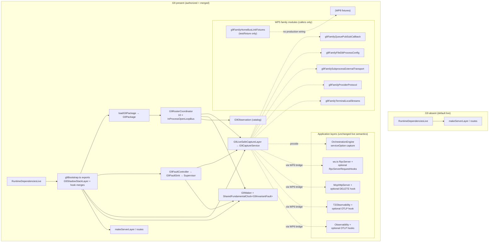

# SCM G9 WP7 bootstrap and live composition — definition plan (U4)

<!-- Agent: definition only. No apps/server/src/scm/g9*.ts. No authorization.md. Do not edit server.ts in this pass. Do not execute. -->

- Date: 2026-10-17
- Unit: **U4** (G9 Manager charter)
- Governing design: `docs/superpowers/specs/2026-09-26-scm-g9-shadow-parity-design.md` (roster coordinator, ten buses, families → `captureOccurrence` only)
- Foundation cohesion (WP1–WP4 + slice): `docs/scm/g9/wp1-wp4-foundation-cohesion.md`
- WP5 family bundles: `docs/superpowers/plans/2026-10-17-scm-g9-wp5-family-bundles-plan.md`
- WP6 typed hooks: `docs/superpowers/plans/2026-10-17-scm-g9-wp6-typed-hooks-plan.md`
- Integration allocation: `docs/scm/g9/integration-readiness.md` §4 WP7 row, §6 serial hotspots
- Machine validation: `docs/scm/g9/coverage-validation.json`

## Authorization

```yaml
implementation_authorized: false
writing_plans_authorized: true # planning definition only; mirrors coverage-validation.json
```

Do **not** create `docs/scm/g9/authorization.md`, flip `g9toG10Authorized`, edit `apps/server/src/server.ts`, create runtime `apps/server/src/scm/g9*.ts`, or land bootstrap wiring in this pass.

---

## 1. Outcome

Deliver a **closed definition** for how a future authorized session **joins** the G9 shadow stack into the T3 server Effect runtime so that:

1. **`G9RosterCoordinator`** — exactly **ten** distinct G3 runtime bus IDs as keys, each backed by one **`InProcessOpenLoopBus`** instance; implements `FundamentalTimestepTarget<G9InvariantFault>`; **`admitShadowPublish`** → G6 `admitPublish`; **no** `comm_id`-keyed bus map; **no eleventh production bus**.
2. **Registry** — init-time **`loadG9Package`** (74-row declarations, governed classes, runtime parameters, G1B/G3/G9 set equality and SHA pins) feeds the coordinator and family validation; no second hand-maintained row list.
3. **Capture service** — optional **`G9CaptureService`** via **`G9LiveSafeCaptureLayer(coordinator, faults, pkg, waker)`** (RFC-018 arity): families/hooks call `captureOccurrence` only; error channel **`never`**; capture defects → **`capture-defect`** + sandboxed latch/sink.
4. **Waker under supervisor** — **`G9Waker`** on the G9-private **`SharedFundamentalClock<G9InvariantFault>`**; bootstrap **`forkScoped`** (or equivalent) under the G9 scope that owns `G9FaultSink`; cadence via `process_interval_wake_ms` at WP7 (Task 10 still does not sleep). **Isolate at `tick` + supervise fiber** (RFC-018): defects/`admitPublish` Die become **`waker-defect`**, `sink.deliver`, state **`faulted`** — never silent-kill, never skip-forever `armed-in-flight`, never die the live server scope without sink delivery. Present mode **arms** the waker (no present-but-never-armed hole).
5. **Optional typed hooks (WP6)** — merged **only** in intended T2 consumer layers: `apps/server/src/ws.ts` (RpcServer stack), `apps/server/src/mcp/McpHttpServer.ts` (session-delete phase), `apps/server/src/t2Observability/T2Observability.ts`, `apps/server/src/observability/Layers/Observability.ts` — **not** generic HTTP middleware; hook services absent ⇒ **unchanged** live RPC/MCP/OTLP behavior.
6. **WP5 family surfaces** — six family modules (`g9Family*.ts`) remain **callers** of `captureOccurrence`; WP7 provides the **shared** coordinator + capture layer they depend on; live-file edits from WP5 stay in those bundles’ integrator rules — WP7 does not re-own family hotspot files except where bootstrap **provides** the capture service globally.
7. **G9 Layer absent ⇒ current live unchanged** — when the bootstrap owner does **not** merge the G9 composition layer (or merge is gated off), the server runtime must match today: no G9 services in context, no waker ticks, no shadow buses on the live fabric, orchestration/RPC/HTTP paths identical to pre-G9 wiring.
8. **Hard negatives (design law)** — **no** production **`BidirectionalHomeBusLink`** as roster fabric or clock target; **no** live forward re-bridge for `INV-T2-SCM-HOME-BUS-LINK` (B6 fixtures / WP8 only); dormant row must not activate from bootstrap.

When `implementation_authorized` becomes true, WP7 implementation will add a **single composition module** (proposed: `apps/server/src/scm/g9Bootstrap.ts` — name RFC with U1 C1) and **minimal** `server.ts` joins owned exclusively by **`WP7-Bootstrap-Owner`**.

---

## 2. Depends on (definition closed)

WP7 composition planning **binds** only after these definition units are closed (Manager blind consensus), without re-opening WP1–WP4 law:

| Prerequisite    | Closed artifact                                                               | WP7 consumes                                                                                                                   |
| --------------- | ----------------------------------------------------------------------------- | ------------------------------------------------------------------------------------------------------------------------------ |
| WP1–WP4 + slice | `docs/scm/g9/wp1-wp4-foundation-cohesion.md`, foundation plan Tasks 1–13 text | Coordinator, FIFO, fault, waker, observation, live-safe capture, vertical slice acceptance                                     |
| **WP5**         | `docs/superpowers/plans/2026-10-17-scm-g9-wp5-family-bundles-plan.md`         | Six `g9Family*.ts` modules; capture-only law; serial integrators for `Manager.ts` / `provider/**`; no production home-bus-link |
| **WP6**         | `docs/superpowers/plans/2026-10-17-scm-g9-wp6-typed-hooks-plan.md`            | `g9FamilyTypedHooks.ts`, Effect patch inventory, consumer file list; **`server.ts` explicitly not WP6**                        |

WP7 does **not** depend on WP8 definition closure for its **scope**; WP8 depends on WP7 bootstrap being specified.

---

## 3. Serial owner — bootstrap and layer join

| Hotspot                                                                          | Sole owner role            | Others                                                                                                                                          |
| -------------------------------------------------------------------------------- | -------------------------- | ----------------------------------------------------------------------------------------------------------------------------------------------- |
| `apps/server/src/server.ts` (G9 merge / activation gate)                         | **`WP7-Bootstrap-Owner`**  | WP5/WP6 may land capture **call sites** and hook **consumer** layers in other files; **must not** commit concurrent `server.ts` bootstrap edits |
| Proposed `apps/server/src/scm/g9Bootstrap.ts` (or equivalent composition module) | **`WP7-Bootstrap-Owner`**  | Foundation/WP2–WP4 owners authored coordinator/waker/fault modules; WP7 **wires** them only                                                     |
| `patches/effect@4.0.0-beta.103.patch`                                            | **WP6-Effect-Patch-Owner** | WP7 merges optional hook layers **after** patch lands; no WP7 patch edits                                                                       |
| WP5 live-file integrators (`terminal/Manager.ts`, `provider/**`)                 | B5 / B4 per WP5 plan       | WP7 does not substitute for integrators                                                                                                         |

Rules (normative):

- One open bootstrap-editing session at a time; family and hook consumer PRs rebase through **`WP7-Bootstrap-Owner`** before `server.ts` lands.
- Bootstrap must not instantiate **`BidirectionalHomeBusLink`** or add an eleventh **`InProcessOpenLoopBus`** to the coordinator map.
- Production activation of the waker (if any) is **explicit** in bootstrap definition — default planning stance: **optional layer present only when authorized and gated**, not an unconditional 100 ms timer on every dev server until human G9 activation policy says otherwise (see [Open questions](#10-open-questions-rfc-candidates)).

---

## 4. Interfaces consumed from WP1–WP6 (text)

WP7 **does not redefine** these; it **composes** implementations produced under earlier packages.

### WP1 — registry and package load

- **`loadG9Package` / `G9Package`** — repo-root loader; throws plain `Error` on init mismatch (not `G9InvariantFault`).
- **`parseRuntimeParameters` / `G9RuntimeParameters`** — FIFO max, wake ms, fundamental timesteps per N from JSON only.
- **`G9RowDeclaration` / `G9PhaseDeclaration`** — ledger-projected rows for coordinator validation and family routing.
- **Init gates** — `\|runtimeBusIds\| === 10`, 29 placed nodes, G1B=G3=G9 `comm_id` equality (74), governed-classes pin, no authority parent in runtime maps.

### WP2 — core shadow runtime

- **`G9Occurrence` / `freezeOccurrence`**, **`G9CaptureOccurrenceInput`**, **`G9CaptureResult`** (three expected outcomes only).
- **`G9NodeFifos` / `admit`**, **`selectPromotion` / `toW1` / `NodeShadowState`**, retain law.
- **`G9RosterCoordinator`** — `captureOccurrence`, snapshot preflight → commit, `FundamentalTimestepTarget<G9InvariantFault>`.

### WP3 — buses and governance

- Ten **`InProcessOpenLoopBus`** instances keyed by G3 **`bus_id`** (not `comm_id`).
- **`admitShadowPublish`**, **`preflightShadowPublish` / `commitShadowPublish`**, **`hearAs` / `G9HearInput`**, **`GovernedClasses`**, empty initial **`DipMuteStore`**.

### WP4 — waker, fault, observation

- **`G9FaultController` / `G9FaultSink`**, **`G9Waker` / `G9WakerState`**, **`G9Observation` / `sandboxObserve`** (closed catalog).
- **`SharedFundamentalClock<G9InvariantFault>`** (G8 Task 2 generic **`E`**) dedicated to G9 waker — **separate** from any live home-bus-link clock target.

### Slice + live-safe boundary (foundation Task 11)

- **`G9CaptureService` / `G9CaptureServiceShape`**, **`G9LiveSafeCaptureLayer`**, **`captureIfOfferAccepted`**, **`commandTypeOf`** — orchestration offer path uses **`Effect.serviceOption(G9CaptureService)`** only.

### WP5 — family bundles (capture callers)

- Six modules: **`g9FamilyQueuePubSubCallback`**, **`g9FamilyFileDbProcessConfig`**, **`g9FamilySubprocessExternalTransport`**, **`g9FamilyProviderProtocol`**, **`g9FamilyTerminalLocalStreams`**, **`g9FamilyHomeBusLinkFixtures`** (fixtures/non-production for dormant row).
- **Law:** families call **`captureOccurrence({ comm_id, phase, input })` only**; WP7 provides the service instance they resolve through context (direct coordinator access forbidden from family modules).

### WP6 — typed hooks (optional services)

- **`g9FamilyTypedHooks.ts`** — maps patch callbacks → `captureOccurrence` through live-safe layer.
- **`RpcServerRequestHooks`** (proposed tag) — optional in **`ws.ts`** RpcServer layer stack.
- MCP **`mcp-http-session-deleted`**, T2/T3 OTLP post-success hooks — optional layers in listed consumer files only.
- **Absent hook service ⇒ unchanged live**; hook fault ⇒ G9 escalation, **no** live result rewrite.

---

## 5. Layer composition (bootstrap graph)

### 5.1 Intent (text)

Bootstrap builds one **optional** **`G9ShadowStackLayer`** (name provisional) that:

1. Loads **`G9Package`** once at layer construction (init failure prevents server start **only when** G9 layer is merged — absent layer skips load entirely).
2. Constructs **`G9RosterCoordinator`** with ten open-loop buses + G6/G7 consult surfaces wired per foundation Task 8.
3. Constructs **`G9FaultController`** with **`G9FaultSink`** aimed at the existing supervisor delivery path (same process identity as G7/G8 fault propagation — exact symbol chosen at implementation).
4. Constructs **`G9Waker`** bound to G9-only **`SharedFundamentalClock<G9InvariantFault>`** and coordinator; waker lifecycle tied to server activation policy (start/stop with bootstrap owner decision).
5. Publishes **`G9LiveSafeCaptureLayer(coordinator, faults, pkg, waker)`** as the sole production provider of **`G9CaptureService`**.
6. Does **not** author WP6 hook service bodies inside `server.ts` — WP7 **`provideMerge`s** hook bridge layers into **`websocketRpcRouteLayer`**, **`McpHttpServer.layer`**, and observability stacks **from** `g9Bootstrap.ts` exports. Per **RFC-008 A** / **RFC-014**, optional G9 deps join via `RuntimeDependenciesLive`; optional RpcServer **route fragment** wiring may join via `makeServerLayer` as a thin ordered merge of those exports — still no hook implementation in `server.ts`.

**Absent path:** `RuntimeDependenciesLive` / `makeServerLayer` pipeline unchanged; no `G9CaptureService`, no G9 clock, no shadow buses allocated.

### 5.2 Mermaid (planning view)



### 5.3 Merge order constraints (normative text)

1. **`G9ShadowStackLayer`** merges **below** application services that call `G9CaptureService` (orchestration, provider, terminal, persistence hooks) so `serviceOption` resolves when present.
2. **WP6 hook layers** merge at **route/transport** composition sites (`makeRoutesLayer` subtree), not inside coordinator code.
3. **G4–G8 live modules** remain authoritative for live buses used outside G9; G9 buses are **private instances** — no aliasing of live Effect bus singletons into the coordinator map.
4. **Observation** sandboxing: bootstrap must not let observation failures roll back coordinator state (WP4 `sandboxObserve` law).

---

## 6. File ownership (future implementation)

| Path                                                                 | Owner                          | WP7 role                                                                  |
| -------------------------------------------------------------------- | ------------------------------ | ------------------------------------------------------------------------- |
| `apps/server/src/server.ts`                                          | **WP7-Bootstrap-Owner**        | Conditional `Layer.provideMerge(G9ShadowStackLayer)` (or equivalent gate) |
| `apps/server/src/scm/g9Bootstrap.ts` (proposed)                      | **WP7-Bootstrap-Owner**        | Construct coordinator, fault, waker, capture, export hook merge helpers   |
| `apps/server/src/scm/g9Package.ts` … `g9Waker.ts`                    | WP1–WP4 owners per U1 file map | Consumed, not edited by WP7 except import wiring                          |
| `apps/server/src/scm/g9Family*.ts`                                   | WP5 bundle owners              | Depend on `G9CaptureService`; no coordinator import                       |
| `apps/server/src/scm/g9FamilyTypedHooks.ts`                          | WP6 hook owner                 | WP7 provides capture + optional hook layer exports                        |
| `apps/server/src/ws.ts`, `mcp/McpHttpServer.ts`, T2/T3 observability | WP6 consumer owners            | WP7 calls exported `Layer` fragments from bootstrap                       |
| `apps/server/src/scm/g6HomeBusLink.ts`                               | G6 owner                       | **Not** instantiated by WP7 bootstrap                                     |

Parallelization after bootstrap owner assigned: WP5/WP6 consumer diffs may proceed in parallel **if** they do not touch `server.ts` until bootstrap owner integrates.

---

## 7. Acceptance gates (when implementation authorized)

WP7 is **not** WP8 complete G9. Gates below are **bootstrap + live noninterference**; full fixture proof remains WP8.

### 7.1 Boot — G9 Layer absent

1. Server starts with **no** `G9ShadowStackLayer` merge (or gate off): identical behavior to baseline for orchestration dispatch, WebSocket RPC smoke paths, and HTTP route mounting.
2. **`OrchestrationEngine.test.ts`** and existing RPC/orchestration integration tests pass **without** G9 services.
3. No G9 shadow buses, waker timers, or `t2.scm.shadow.*` spans/metrics from production bootstrap.
4. **`loadG9Package` is not invoked** on absent path (no init-time 74-row load side effect).

### 7.2 Boot — G9 Layer present

1. Server starts with merged bootstrap: **`loadG9Package`** succeeds on pinned ledger; coordinator map has **exactly ten** bus keys; authority parent and `node.observer.404` reject paths remain covered by existing WP3 tests.
2. **`G9CaptureService`** available to orchestration and family call sites; **`captureOccurrence`** error channel **`never`** at boundaries.
3. **Waker** obeys four-state law; skip-if-busy; no wall catch-up; faults disarm waker and reach supervisor sink.
4. **No** `BidirectionalHomeBusLink` construction in bootstrap or coordinator factory.
5. WP6 hooks are **not** an independent production mode. One atomic RFC-003 gate (absent \| present) controls both `G9LiveSafeCaptureLayer` and WP6 hook layer fragments. “Hook layers absent” is a **unit-test** configuration for WP6 isolation only — production present mode must not leave RpcServer/MCP/OTLP capture unwired while the capture Layer is merged (RFC-003 / cohesion C7).

### 7.3 Live RPC / orchestration still pass (both modes)

| Mode    | Required                                                                                                                                                                                |
| ------- | --------------------------------------------------------------------------------------------------------------------------------------------------------------------------------------- |
| Absent  | Full existing orchestration + RPC regression set used for server CI (targeted: `OrchestrationEngine.test.ts`, websocket RPC route tests, foundation slice assertions where applicable). |
| Present | Same suites pass; **plus** vertical slice behaviors where enabled (ORCH-QUEUE offer → occurrence → timestep → `hearAs`) without dispatch failures after successful offer.               |

### 7.4 Package / cohesion (unchanged global gates)

- `docs/scm/g9/coverage-validation.json` — `implementation_authorized` still false until human authorization file exists; WP7 landing does not flip flags in definition planning.
- `python3 docs/scm/g9/regen_coverage_ledger.py` / exact-set equality unchanged.
- G3–G8 SCM unit tests still pass when G9 absent; G9 module tests pass when present.

---

## 8. Non-goals

| Non-goal                                                      | Rationale                                                                                                      |
| ------------------------------------------------------------- | -------------------------------------------------------------------------------------------------------------- |
| **WP8 exact-set proof**                                       | 763-fixture runner, full row coverage, dormant fixture execution policy — WP8 (`integration-readiness.md` §4). |
| **Runtime in this definition pass**                           | U4 deliverable is markdown only; no `g9*.ts`, no `server.ts` edits.                                            |
| **Completing WP5/WP6 implementation**                         | WP7 assumes family and hook modules exist; composition does not substitute for bundle work.                    |
| **Effect patch ownership**                                    | WP6 serial owner only.                                                                                         |
| **Production home-bus-link fabric**                           | Design + WP5 B6 + charter cohesion; bootstrap must not activate dormant row.                                   |
| **Eleventh bus or comm_id-keyed bus map**                     | Design topology law.                                                                                           |
| **G9 self-disposition of live stack**                         | Faults propagate to supervisor; G9 does not freeze/halt live services.                                         |
| **Generic HTTP middleware capture**                           | WP6 typed hooks only at named seams.                                                                           |
| **Flipping `implementation_authorized` / `authorization.md`** | Human gate only.                                                                                               |

---

## 9. Proposed implementation sequence (not executed here)

1. G9 Manager assigns **`WP7-Bootstrap-Owner`** after WP5/WP6 implementation owners land **callable** family/hook modules (empty family stubs forbidden — cohesion §2 / RFC-023).
2. Bootstrap owner implements **`g9Bootstrap.ts`**: package load, coordinator, fault sink → supervisor, waker, `G9LiveSafeCaptureLayer`, exported hook layer fragments.
3. Bootstrap owner adds **gated** merge in **`server.ts`** (single PR stream).
4. Verify **absent** and **present** acceptance (§7) before WP8 fixture marathon.
5. WP8 adds generated fixture runner atop running bootstrap — out of WP7 scope.

---

## 10. Open questions — Manager-answered (as they came up)

| #   | Topic                        | Manager RFC              | Decision                                                                                            |
| --- | ---------------------------- | ------------------------ | --------------------------------------------------------------------------------------------------- |
| 1   | Production activation gate   | **RFC-003 A**            | Env/settings opt-in merges Layer; default **absent**                                                |
| 2   | Supervisor sink symbol       | (implement-time binding) | Deliver to existing G7/G8 supervisor owning halt/freeze; name tag in WP7 module header at code time |
| 3   | Module naming                | **RFC-001 B**            | `g9ShadowParity.ts` re-exports modular File Map                                                     |
| 4   | `server.ts` merge anchor     | **RFC-008 A**            | Both: deps via `RuntimeDependenciesLive`; routes via `makeServerLayer`                              |
| 5   | Waker start policy           | (follows RFC-003)        | Arm only when Layer present (opt-in); no unconditional 100 ms timer when absent                     |
| 6   | Third mode (merged, unwired) | **RFC-003 A**            | **Forbidden** — two-mode only                                                                       |
| 7   | Init failure when G9 on      | **RFC-009 A**            | Fail-fast server                                                                                    |
| 8   | Test bootstrap reuse         | (normative)              | Export same `G9ShadowStackLayer` factory for Task 12 / WP8; no duplicate coordinator wiring         |

Resolver: G9 Manager. See `docs/scm/g9/rfc-queue.md`.

---

## Authoritative cross-links

| Document                                                                 | Role                                    |
| ------------------------------------------------------------------------ | --------------------------------------- |
| `docs/scm/g9/manager-charter.md`                                         | U4 unit; blind consensus                |
| `docs/scm/g9/integration-readiness.md`                                   | WP7 row; bootstrap serial hotspot       |
| `docs/scm/g9/wp1-wp4-foundation-cohesion.md`                             | Interface index; Task 12 test-only note |
| `docs/superpowers/plans/2026-09-30-scm-g9-foundation-orch-queue-plan.md` | Coordinator/waker/capture source tasks  |
| `docs/superpowers/plans/2026-10-17-scm-g9-wp5-family-bundles-plan.md`    | Six family modules                      |
| `docs/superpowers/plans/2026-10-17-scm-g9-wp6-typed-hooks-plan.md`       | Hook consumers; WP7 owns `server.ts`    |
| `docs/superpowers/specs/2026-09-26-scm-g9-shadow-parity-design.md`       | Ten-bus roster, no home-bus-link fabric |

---

_U4 deliverable: definition only. No runtime files. No `server.ts` edits. No commits._
